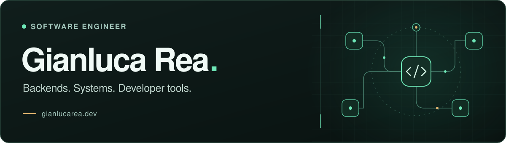

<a href="https://gianlucarea.dev">
  <picture>
    <source media="(prefers-color-scheme: dark)" srcset="./assets/profile-dark.svg">
    <source media="(prefers-color-scheme: light)" srcset="./assets/profile-light.svg">
    
  </picture>
</a>

<p align="center">
  <a href="https://gianlucarea.dev"><strong>Portfolio ↗</strong></a> &nbsp; · &nbsp;
  <a href="https://www.linkedin.com/in/gianlucarea"><strong>LinkedIn ↗</strong></a> &nbsp; · &nbsp;
  <a href="mailto:gianlucarea.work@gmail.com"><strong>Get in touch ↗</strong></a>
</p>

# Hi, I'm Gianluca.

**I build backend systems at work and developer tools out of curiosity.**

I'm an Italian-Canadian software engineer based in L’Aquila, Italy. My professional work centers on **Java, Spring Boot, REST APIs, and distributed systems**. Outside work, I build with **Go, Rust, and TypeScript**—usually to make something I'd want to use myself.

[At a glance](#at-a-glance) · [Explore my projects](#explore-my-projects) · [Toolbox](#toolbox) · [Beyond the terminal](#beyond-the-terminal)

## At a glance

- **Software Engineer at [OverIT](https://github.com/overit-official)** · Built **40+ REST APIs** for billing and subcontractor workflows on a multi-tenant enterprise platform.
- **Previously, University of L’Aquila × RFI** · Developed train-movement state machines for a digital twin simulating **10,000+ trains daily**.
- **A practical improvement** · Built editors that cut train-configuration time from **30 minutes to 5**.
- **MSc in Advanced Software Engineering, cum laude** · University of L’Aquila. Italian and English speaker.

<details>
<summary><strong>Open my experience timeline</strong></summary>

**OverIT · Software Engineer** · May 2024–present<br>
Java/Spring Boot integrations, production defects across work-order and scheduling flows, and Oracle schema refactoring for a multi-tenant platform.

**University of L’Aquila, in collaboration with RFI · Research Software Engineer** · Jul 2022–Apr 2024<br>
Model-driven rail simulation, train state transitions, and editors for timetables and train configuration.

**Mercurio Service · Software Developer Intern** · May–Nov 2021<br>
Shipping-label tools implementing Poste Italiane QR-code and barcode standards.

**Education:** MSc, Advanced Software Engineering, cum laude (2023) · BSc, Computer Science (2021), University of L’Aquila.

[More about my background on LinkedIn →](https://www.linkedin.com/in/gianlucarea)

</details>

## Explore my projects

Pick an interest. Try the software. Follow it into the code.

| Project | What to explore |
| :--- | :--- |
| [**Tortuga**](https://github.com/gianlucarea/tortuga)<br>Rust | **Systems & observability.** Concurrent HTTP monitoring, a live terminal dashboard, and uptime tracking. |
| [**Parley**](https://github.com/gianlucarea/parley)<br>Go | **Developer experience & APIs.** HTTP requests stored as TOML: readable, diffable, and reviewable in Git. |
| [**M68K Interpreter**](https://github.com/gianlucarea/m68k-interpreter)<br>TypeScript | **Computer architecture.** Assembly execution, live CPU state, and reversible debugging in your browser. |

**[Launch the M68K playground →](https://gianlucarea.dev/m68k-interpreter/)** &nbsp; No installation required.

<details>
<summary><strong>🏴‍☠️ Tortuga — how I keep an eye on HTTP services</strong></summary>

An endpoint monitor for people who live in the terminal. It polls services concurrently, shows their status in a Ratatui dashboard, and sends Telegram or webhook notifications when availability changes.

- **Under the hood:** Rust, Tokio, Ratatui; independent polling tasks with configurable intervals and timeouts.
- **Worth exploring:** how live dashboard updates, alerting, and persisted uptime state fit together.

[Explore the code](https://github.com/gianlucarea/tortuga) · [Setup guide](https://github.com/gianlucarea/tortuga#readme) · [Project notes](https://gianlucarea.dev/projects/tortuga)

</details>

<details>
<summary><strong>🏴‍☠️ Parley — API collections that belong in Git</strong></summary>

A terminal HTTP client built around plain TOML collections. Requests live alongside your code, so a change to an API call can be reviewed like any other change.

- **Under the hood:** Go, Bubble Tea, Lip Gloss; a three-pane interface, environment substitution, and bearer/basic authentication.
- **Worth exploring:** the path from a readable request definition to an interactive terminal workflow.

A collection starts this simply:

```toml
[[requests]]
name = "Hello, HTTP"
method = "GET"
url = "https://example.com"
```

[Explore the code](https://github.com/gianlucarea/parley) · [Setup guide](https://github.com/gianlucarea/parley#readme) · [Project notes](https://gianlucarea.dev/projects/parley)

</details>

<details>
<summary><strong>🧠 M68K Interpreter — take a tiny program apart</strong></summary>

What began with my bachelor's thesis became a browser-based Motorola 68000 learning environment. Write assembly, step through it, inspect registers and memory, then undo execution to see how the state changed.

- **Under the hood:** TypeScript, React, a custom parser and interpreter, and reversible execution history.
- **Worth exploring:** the connection between instruction semantics, state transitions, and a UI that makes them visible.

**A 30-second experiment:** [open the playground](https://gianlucarea.dev/m68k-interpreter/), paste this program, and step through it. What ends up in `D0`?

```asm
MOVEQ #40, D0
ADDQ.L #2, D0
END
```

<details>
<summary>Reveal the result</summary>

**42**, or `0x0000002A`. `MOVEQ` loads 40 into `D0`; `ADDQ.L` adds 2. Step backward to watch the previous state return.

</details>

[Explore the code](https://github.com/gianlucarea/m68k-interpreter) · [Project notes](https://gianlucarea.dev/projects/interpreter) · [Read the build story](https://gianlucarea.dev/posts/m68k-march26)

</details>

[More projects: autonomous systems, optimization, and machine learning →](https://gianlucarea.dev/projects)

## Toolbox

| Context | Technologies |
| :--- | :--- |
| **Professional backend work** | Java · Spring Boot · REST APIs · Oracle Database |
| **Projects & experiments** | Go · Rust · TypeScript · React · Python |
| **Also in my toolkit** | PostgreSQL · Redis · RabbitMQ · Docker · GitHub Actions · Grafana |

## Beyond the terminal

My curiosity started with a broken package on Ubuntu 12.04. I still like finding out why something broke—and how it works underneath.

Away from code, I'm a husband and dad with a soft spot for football, history, and worlds with deep lore. Fishing and BBQ are on the someday list.

[Read my writing](https://gianlucarea.dev/posts) · [Visit my corner of the internet](https://gianlucarea.dev)

---

**Have a backend challenge, a role to discuss, or an idea for one of these tools?**

[Email me](mailto:gianlucarea.work@gmail.com) · [Connect on LinkedIn](https://www.linkedin.com/in/gianlucarea) · [Back to the top ↑](#hi-im-gianluca)
